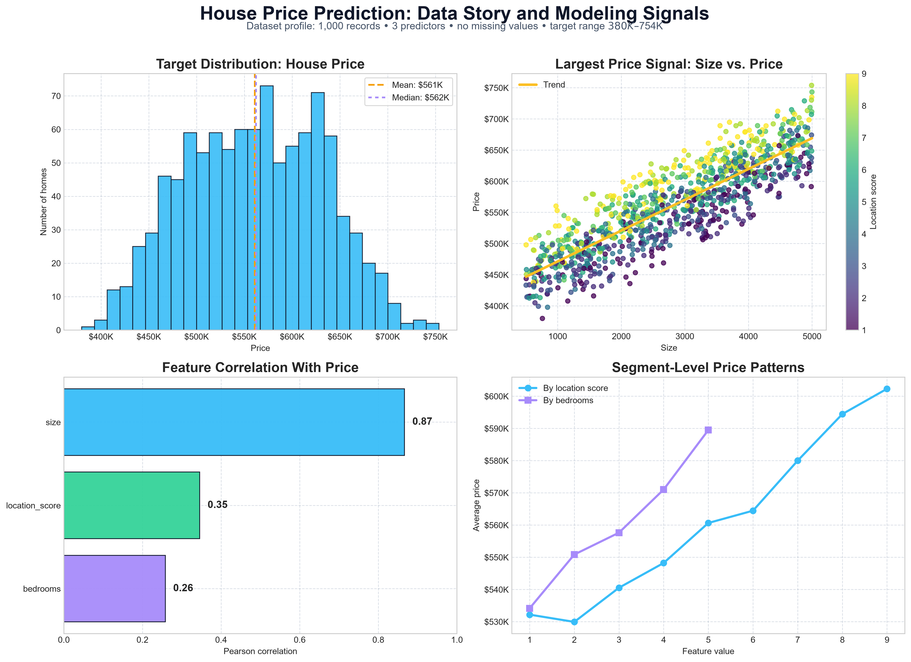

# Neural Network House Price Prediction



## About

This project builds a neural-network regression workflow for predicting house prices from structured property features. The goal is not only to train a deep learning model, but also to evaluate whether neural-network complexity is justified against simpler regression baselines.

The project uses three input features:

- property size
- location score
- number of bedrooms

The final notebook includes data validation, exploratory analysis, feature scaling, neural-network training, real-dollar model evaluation, benchmark comparison, residual diagnostics, and feature-driver analysis.

## Project Overview

House price prediction is a practical regression problem where models learn how property characteristics relate to sale price. This project trains a neural network to estimate prices, then compares its performance against linear and tree-based models on the same train/test split.

The workflow includes:

- loading and validating the housing dataset
- checking missing values and duplicates
- exploring feature relationships with price
- splitting the data into training and test sets
- scaling input features and the target variable
- building and training a TensorFlow/Keras neural network
- converting predictions back into real dollar values
- evaluating model performance with MAE, RMSE, and R²
- benchmarking against Linear Regression, Ridge Regression, Random Forest, and Gradient Boosting
- analyzing residuals and prediction error patterns
- estimating feature influence with standardized linear effects and permutation importance
- exporting portfolio-ready visuals to the `images/` folder

## Dataset

The dataset contains 1,000 housing records with three predictors and one target variable.

| Field | Description |
|---|---|
| `size` | Property size |
| `location_score` | Numeric score representing location quality |
| `bedrooms` | Number of bedrooms |
| `price` | Target house price |

Dataset profile from the notebook:

| Attribute | Value |
|---|---:|
| Rows | 1,000 |
| Predictors | 3 |
| Missing values | 0 |
| Duplicate rows | 0 |
| Target range | Approximately $380K to $754K |

## Model Architecture

The neural network was built with TensorFlow/Keras and trained as a tabular regression model.

Architecture:

- input layer with 3 features
- dense hidden layer with 64 neurons and ReLU activation
- dense hidden layer with 32 neurons and ReLU activation
- output layer with 1 neuron for price prediction

Training setup:

| Component | Value |
|---|---|
| Optimizer | Adam |
| Learning rate | 0.01 |
| Loss function | Mean Squared Error |
| Evaluation metric | Mean Absolute Error |
| Regularization workflow | Early stopping on validation loss |

Because the target was scaled during training, predictions were inverse-transformed before reporting final performance. This makes the results interpretable in real dollar terms.

## Model Performance

The neural network achieved strong test performance after converting predictions back to dollar values.

| Metric | Neural Network Result |
|---|---:|
| MAE | $11,565.78 |
| RMSE | $13,940.08 |
| R² | 0.961 |

The MAE means the model's predictions were off by about $11.6K on average on the test set.

## Benchmark Comparison

A key improvement in this project is the addition of baseline models. This makes the analysis more credible because the neural network is compared against simpler alternatives instead of being evaluated in isolation.

| Model | MAE |
|---|---:|
| Neural Network | $11,565.78 |
| Linear Regression | $11,798.37 |
| Ridge Regression | $11,807.38 |
| Gradient Boosting | $12,667.65 |
| Random Forest | $13,618.12 |

The neural network produced the lowest MAE in the latest run, but the linear models performed very close behind it. This suggests that the dataset has a strong mostly linear structure, especially around property size. The project is therefore best interpreted as a disciplined regression modeling workflow, not as a claim that deep learning is always superior for tabular data.

## Visual Analysis

The notebook exports portfolio-ready visuals to the project-level `images/` folder, including:

- `house_price_data_story.png`
- `house_price_nn_training_curves.png`
- `house_price_prediction_diagnostics.png`
- `house_price_model_benchmark.png`
- `house_price_feature_drivers.png`

The main README visual, `house_price_data_story.png`, summarizes the dataset distribution, the dominant size-price relationship, feature correlations, and segment-level price patterns.

## Key Insights

- Property size is the strongest predictor of house price in this dataset.
- Location score and bedrooms add useful secondary signal.
- The neural network achieved a test MAE of about $11.6K and an R² of 0.961.
- Linear Regression and Ridge Regression were highly competitive, which suggests the feature-target relationships are mostly linear.
- Residual diagnostics show prediction errors are relatively contained across the test set, with no major breakdown in the main price range.
- Benchmarking improved the project because it shows model selection judgment rather than relying on a neural network alone.
- Feature-driver analysis confirms that size dominates the prediction signal, while location quality and bedroom count provide additional explanatory value.

## Repository Structure

```text
house_price_prediction/
  data/
    housing_prices.csv
  images/
    house_price_data_story.png
    house_price_nn_training_curves.png
    house_price_prediction_diagnostics.png
    house_price_model_benchmark.png
    house_price_feature_drivers.png
  notebooks/
    house_price_prediction_nn.ipynb
  .gitignore
  README.md
```

## Notebook

The main notebook is located at:

```text
notebooks/house_price_prediction_nn.ipynb
```

Run the notebook from the `notebooks/` folder. The visualization setup is configured to save outputs into the project-level `images/` folder.

## Tools and Libraries

- Python
- Pandas
- NumPy
- TensorFlow / Keras
- Scikit-learn
- Matplotlib
- Jupyter Notebook

## Author

Edidiong Ibokete  
[GitHub Profile](https://github.com/Eddy-bok)
